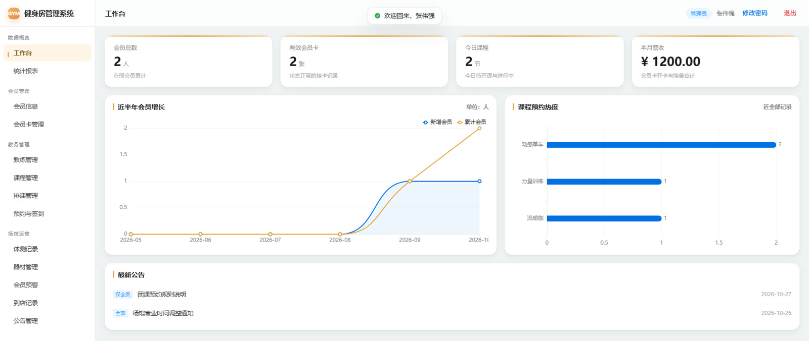
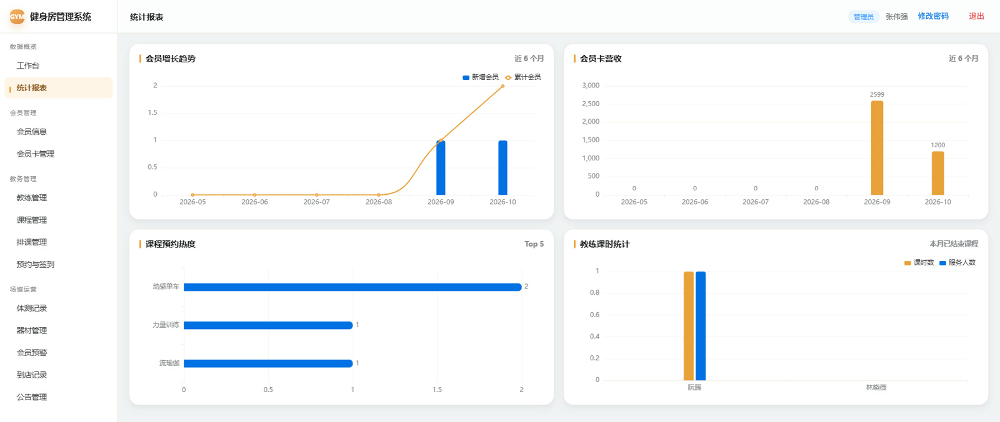
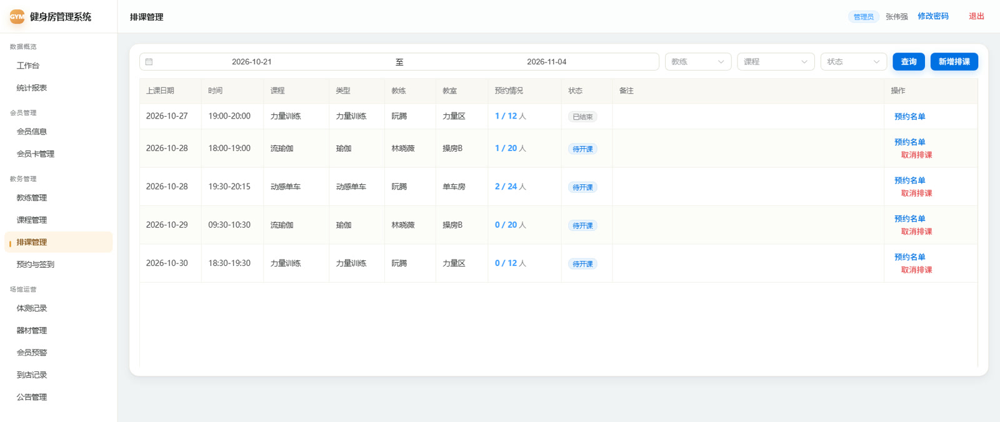
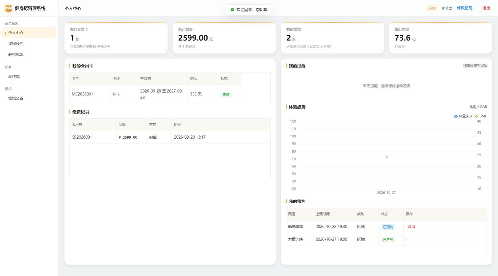
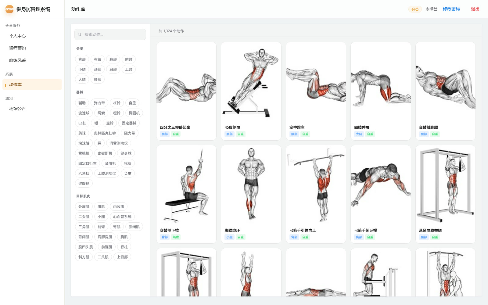
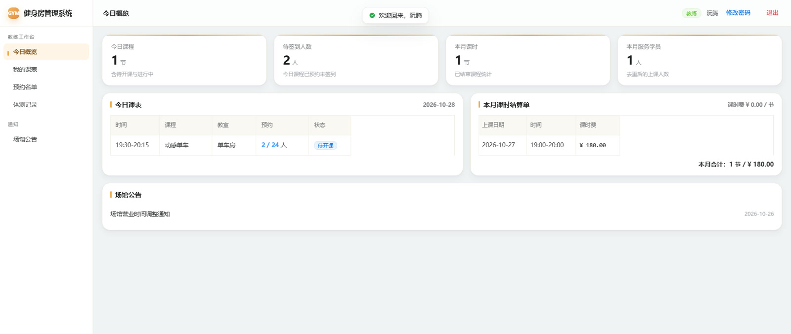
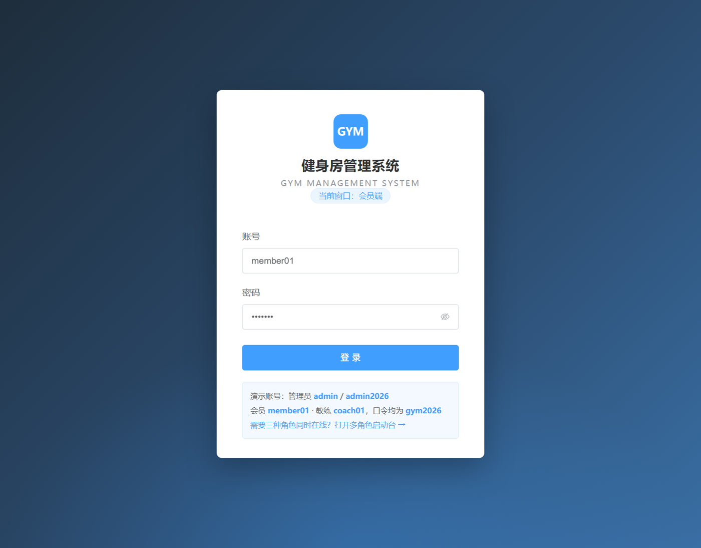

# 健身房管理系统 Gym Management System

基于 **Spring Boot 3 + Vue 3** 的健身房会员管理系统，覆盖会员档案、会员卡、教练、课程、排课、预约签到、体测、器材、到店记录与经营报表，并内置一个 **1,324 个动作的健身动作库**。

前后端一体打包，内置 H2 内存数据库，**`java -jar` 直接跑，不需要先装 MySQL**。

---

## 目录

- [界面预览](#界面预览)
- [功能](#功能)
- [技术栈](#技术栈)
- [快速开始](#快速开始)
- [演示账号](#演示账号)
- [目录结构](#目录结构)
- [动作库模块](#动作库模块)
- [配置说明](#配置说明)
- [部署](#部署)
- [更新日志](#更新日志)
- [已知限制](#已知限制)
- [素材授权](#素材授权)

---

## 界面预览

<table>
  <tr>
    <td width="50%"><br><sub><b>管理端 · 工作台</b>　今日到店、营收、会员增长与课程热度</sub></td>
    <td width="50%"><br><sub><b>管理端 · 统计报表</b>　会员增长、卡营收、课程热度、教练课时</sub></td>
  </tr>
  <tr>
    <td width="50%"><br><sub><b>管理端 · 排课管理</b>　按周排课、预约情况与开课状态</sub></td>
    <td width="50%"><br><sub><b>会员端 · 个人中心</b>　会员卡、缴费、体测趋势与我的预约</sub></td>
  </tr>
  <tr>
    <td colspan="2"><br><sub><b>会员端 · 动作库</b>　1,324 个动作，iframe 内嵌在主页面里，不跳转、不打断登录态；左侧是主系统菜单，中间是动作库的搜索与筛选，右侧是动作卡片</sub></td>
  </tr>
  <tr>
    <td width="50%"><br><sub><b>教练端 · 今日概览</b>　今日课程、预约人数与课时结算</sub></td>
    <td width="50%"><br><sub><b>登录页</b>　按角色隔离会话，可多角色同时在线</sub></td>
  </tr>
</table>

> 截图中的会员与教练为内置演示数据（`member01` / `coach01`），不是真实用户信息。

---

## 功能

### 管理员端

| 模块 | 能力 |
|---|---|
| 工作台 | 今日到店、营收、会员增长、课程满员率等核心指标 |
| 统计报表 | 营收趋势、课程热度、会员结构（ECharts 可视化） |
| 会员信息 | 建档、检索、编辑、状态管理 |
| 会员卡管理 | 期限卡 / 次卡 / 储值，充值、续费、到期提醒 |
| 教练管理 | 教练档案、专长、课时费、在职状态 |
| 课程管理 | 课程类型、时长、容量、消耗热量 |
| 排课管理 | 按周排课、教练与教室冲突校验 |
| 预约与签到 | 预约名单、到场签到、爽约记录 |
| 体测记录 | 身高体重、体脂、围度、BMI 自动计算 |
| 器材管理 | 器材台账、状态、维保日期 |
| 会员预警 | 到期预警、流失预警（定时任务扫描） |
| 到店记录 | 出入场流水 |
| 公告管理 | 场馆公告发布 |

### 会员端

个人中心（会员卡 / 缴费 / 预约 / 体重趋势）、课程预约、教练风采、**动作库**、场馆公告。

### 教练端

今日概览、我的课表、预约名单、体测记录、课时结算、场馆公告。

---

## 技术栈

| 层 | 选型 |
|---|---|
| 后端框架 | Spring Boot 3.2.5 / Java 17 |
| ORM | MyBatis-Plus 3.5.7 |
| 数据库 | H2 内存库（MySQL 兼容模式，演示用）· MySQL 8（生产可切换） |
| 认证 | 自建 Token（登录后写入请求头，按角色隔离会话） |
| 前端 | Vue 3（global build）+ Element Plus + ECharts + Axios，无构建步骤 |
| 动作库 | 纯静态 HTML/JS，1,324 个动作，数据以 JSON 外链加载 |

**没有 Node 构建链**：前端是 `static/index.html` + `js/*.js`，直接由 Spring Boot 托管，改完刷新即可。

---

## 快速开始

### 前置

- JDK 17+
- Maven 3.8+（或直接用 IntelliJ IDEA 内置的 Maven）

### 方式一：源码运行

```bash
cd gym-management
mvn spring-boot:run
```

### 方式二：打包后运行（推荐，动作库路径最省事）

```bash
cd gym-management
mvn clean package -DskipTests

# 回到项目根目录再启动，动作库的相对路径才能找到
cd ..
java -jar gym-management/target/gym-management.jar
```

打开 <http://127.0.0.1:8080/>

### 方式三：Windows 一键启动

双击项目根目录的 `启动健身房系统.cmd`（前提是已经打过包，且 8080 端口空闲）。

### 关于动作库路径

`application.yml` 默认：

```yaml
gym:
  exercises:
    dir: ${GYM_EXERCISES_DIR:file:./exercises-dataset/}
```

`./` 是**启动时的工作目录**。所以：

- 在**项目根目录**执行 `java -jar gym-management/target/...jar` → 正常
- 在 `gym-management/` 目录里执行 → 找不到动作库，日志会打 WARN，`/exercises/` 返回 404，但主系统照常运行

自定义位置：

```bash
java -jar gym-management/target/gym-management.jar \
  --gym.exercises.dir=file:/data/exercises-dataset/
```

或设环境变量 `GYM_EXERCISES_DIR`。

### 换 MySQL

```yaml
spring:
  datasource:
    driver-class-name: com.mysql.cj.jdbc.Driver
    url: jdbc:mysql://127.0.0.1:3306/gym?useUnicode=true&characterEncoding=utf8&serverTimezone=Asia/Shanghai
    username: root
    password: your_password
  sql:
    init:
      mode: always   # 首次建表用，之后可改 never
```

建表与演示数据在 `gym-management/src/main/resources/db/schema.sql`（15 张表）与 `data.sql`。

---

## 演示账号

| 角色 | 账号 | 口令 |
|---|---|---|
| 管理员 | `admin` | `admin2026` |
| 会员 | `member01` | `gym2026` |
| 教练 | `coach01` | `gym2026` |

需要三种角色同时在线演示，打开 <http://127.0.0.1:8080/launcher.html>（多角色启动台，各自独立会话）。

---

## 目录结构

```
.
├── gym-management/                 Spring Boot 应用
│   ├── pom.xml
│   └── src/main/
│       ├── java/com/ncu/gym/       控制器 / 服务 / 实体 / Mapper / 配置
│       └── resources/
│           ├── application.yml
│           ├── db/                 schema.sql + data.sql
│           └── static/             Vue 3 单页前端
│               ├── index.html      主外壳（登录 + 布局 + 路由）
│               ├── js/core.js      会话、请求封装、菜单定义
│               ├── js/role-pages.js 会员端 / 教练端页面（含动作库内嵌页）
│               ├── js/admin-*.js   管理端页面
│               └── css/theme.css
├── exercises-dataset/              动作库（独立静态模块）
│   ├── index.html                  动作库页面（支持 ?embed=1 内嵌形态）
│   ├── data/exercises.json         1,324 个动作（17MB，gzip 后约 2MB）
│   ├── images/                     静态缩略图
│   ├── videos/                     动作动图（未入库，见下文）
│   └── LICENSE / NOTICE.md         素材授权
├── deploy/nginx-exercises.conf     Nginx 托管动作库的示例配置
├── docs/screenshots/               README 用的界面截图
├── 调研/                           竞品调研、验收报告、动作库集成说明
├── index.html                      项目介绍落地页
└── 启动健身房系统.cmd
```

> 论文与答辩材料含个人身份信息，未纳入本仓库，仅在本地留存。

---

## 动作库模块

### 为什么做成独立模块

1,324 个动作 = 17MB JSON + 139MB 媒体。如果塞进主应用：

- 首屏要拉 17MB，主系统被拖慢
- jar 从 37MB 膨胀到 150MB+
- 每次更新动作数据都要重新打包发布

所以它挂在 `/exercises/`，由 `WebConfig.addResourceHandlers` 映射到外置目录，目录缺失只打 WARN，不影响主系统启动。

### 打开方式：从「跳新标签」改为「缝合进主页面」

**改之前**

```js
// core.js
{ key: 'exercise', label: '动作库', external: true, href: '/exercises/' }

// 点击时
openExternal(item) { window.open(item.href, '_blank', 'noopener'); }
```

点一下就在新标签页里打开完整动作库，主系统的侧栏、面包屑、登录态全部断开，回来还得重新找位置。

**改之后**

```js
// core.js —— 普通页面，不再 external
{ key: 'exercise', label: '动作库' }
```

```js
// role-pages.js —— 用一个 iframe 承载
Gym.define('exercise', {
    template: `
    <div class="exercise-embed">
        <iframe src="/exercises/?embed=1" title="健身动作库"
                loading="lazy" referrerpolicy="no-referrer"></iframe>
    </div>`
});
```

动作库侧检测到 `embed=1`（或发现自己被 iframe 包裹）后，给 `<html>` 加 `embed` 类：

```css
html.embed .sidebar-header { display: none; }   /* 隐藏自己的品牌栏 */
html.embed .sidebar-body { padding-top: 16px; }
```

于是主页面里看到的是：主系统侧栏 + 动作库的搜索筛选栏 + 动作卡片网格，三层结构连成一体，不再跳走。

### 为什么用 iframe，不重写成 Vue 组件

| 方案 | 首屏影响 | 改动量 | 独立更新 |
|---|---|---|---|
| iframe 内嵌 | 无（懒加载） | 约 20 行 | 支持 |
| 重写为 Vue 组件 | 17MB JSON 进主包 | 1324 条数据、搜索、筛选、虚拟滚动、弹窗全重写 | 不支持 |

iframe 把 17MB 数据和 1,324 个卡片节点关在自己的文档里，主系统的路由、内存、样式都不受影响；动作库还能独立替换。代价是 iframe 内部的滚动和前进后退不参与主系统路由——对这个场景可以接受。

### 媒体补齐

`videos/`（127MB GIF）不在仓库里，克隆后只有静态缩略图。需要动图时：

```bash
pip install requests
python tools/fetch_media_fast.py --all
```

脚本走 Gitee raw 通道、24 并发，约 1 分钟补齐。`tools/fetch_exercise_media.py` 是按需拉取的备用方案。

### 缓存策略

| 路径 | max-age | 说明 |
|---|---|---|
| `/exercises/images/**`、`/exercises/videos/**` | 7 天 | 文件名带哈希，内容不变 |
| `/exercises/data/**` | 1 小时 | JSON 数据 |
| `/exercises/**` | 5 分钟 | 页面本体 |

`application.yml` 已开 gzip，17MB 的 JSON 传输约 2MB。前置 Nginx 时可用 `deploy/nginx-exercises.conf`，注意 `alias` 与 `location` 末尾都要带 `/`。

---

## 配置说明

`gym-management/src/main/resources/application.yml`：

| 配置项 | 默认值 | 说明 |
|---|---|---|
| `server.port` | `8080` | 服务端口 |
| `server.compression.enabled` | `true` | gzip，主要给 17MB 的 JSON 用 |
| `spring.datasource.url` | H2 内存库 | 重启即重置，生产换 MySQL |
| `spring.sql.init.mode` | `always` | 每次启动重建表并灌演示数据 |
| `spring.h2.console.enabled` | `true` | <http://127.0.0.1:8080/h2-console> |
| `gym.exercises.dir` | `file:./exercises-dataset/` | 动作库目录，可用 `GYM_EXERCISES_DIR` 覆盖 |

---

## 部署

### 单机

```bash
mvn clean package -DskipTests
java -jar gym-management/target/gym-management.jar \
  --gym.exercises.dir=file:/data/exercises-dataset/ \
  --server.port=8080
```

### Nginx 前置

```nginx
# 动作库交给 Nginx 直出，省掉 Java 的静态文件开销
location /exercises/ {
    alias /data/exercises-dataset/;
    try_files $uri $uri/ /exercises/index.html;
}
```

完整示例见 `deploy/nginx-exercises.conf`。

> 用 Nginx 托管动作库时，iframe 的 `src="/exercises/?embed=1"` 依然同源，不需要改 CORS。

---

## 更新日志

### v1.1 — 动作库内嵌

- 动作库从「新标签页打开」改为「主系统内 iframe 内嵌」，不再打断布局与登录态
- 动作库支持 `?embed=1` 内嵌形态，自动隐藏自身品牌栏
- 菜单项移除 `external` 声明，改为普通路由页面

### v1.0 — 初版

- 三角色（管理员 / 会员 / 教练）权限隔离
- 15 张表的会员、课程、排课、预约、体测、器材、报表体系
- H2 内存库零配置启动

---

## 已知限制

- **H2 是内存库**，重启数据重置。生产环境必须换 MySQL 并把 `spring.sql.init.mode` 改为 `never`。
- **动作库 iframe 内部**的滚动与浏览器前进/后退不参与主系统路由；刷新页面会回到主系统默认页（`#/exercise` 可直接定位）。
- **`videos/` 未入库**，克隆后动作详情只有静态图，动图需跑一次 `fetch_media_fast.py`。
- 前端没有构建链，Vue / Element Plus 以 global build 直接引入，首屏体积换来了「改完刷新即生效」。
- 认证是自己签的 Token，不是 JWT / OAuth，适合课程设计或内网演示，不适合直接对公网开放。

---

## 素材授权

- **代码**：本仓库代码可用于学习与二次开发。
- **动作库数据与媒体**：来自开源数据集，版权归 [Gym visual](https://gymvisual.com) 所有，仅用于动作示范。原始授权见 `exercises-dataset/LICENSE`、`NOTICE.md`、`NOTICE_zh.md`。二次分发前请自行确认授权范围。
- **字体与图标**：Vue、Element Plus、ECharts 遵循各自的开源协议；落地页引用的 Google Fonts / Font Awesome 为 CDN 外链。

---

## 致谢

- 动作数据集：exercises-dataset（Gitee 社区汉化分支）
- 前端组件：Vue 3、Element Plus、ECharts
- 后端框架：Spring Boot、MyBatis-Plus
